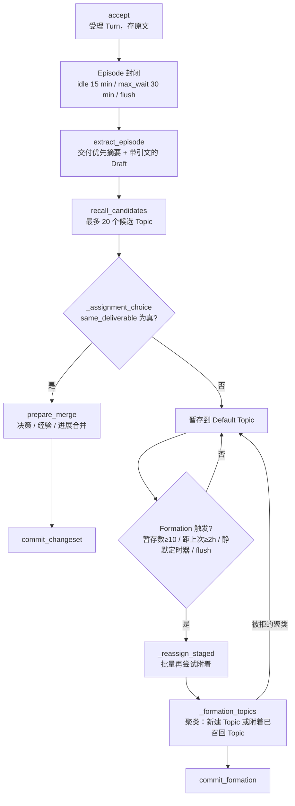

# FrontierMemory Add Topic 归属评测

本分支 `feat/frontiermemory-topic-eval` 用公开的 FrontierMemory 对话轨迹，模拟多个用户交错写入项目记忆，评测 Add 把每个 Turn 归入哪个 Topic。
这份 README 替换了 MemOS 的项目介绍。原介绍见 upstream `main` 分支的 [README](https://github.com/MemTensor/MemOS/blob/main/README.md)，中文版 [README_ZH.md](README_ZH.md) 没有改动。

本文按同事复现的顺序组织：

1. [结论](#1-结论)
2. [评测对象与术语](#2-评测对象与术语)
3. [数据集：什么是 Topic 金标](#3-数据集什么是-topic-金标)
4. [轨迹如何交叉写入](#4-轨迹如何交叉写入)
5. [Add 流程：附着已有 Topic 与新建 Topic](#5-add-流程附着已有-topic-与新建-topic)
6. [怎么判断正确率](#6-怎么判断正确率)
7. [模型与运行配置](#7-模型与运行配置)
8. [评测结果](#8-评测结果)
9. [Badcase 分析](#9-badcase-分析)
10. [复现与比较](#10-复现与比较)
11. [数据目录说明](#11-数据目录说明)
12. [代码索引与测试](#12-代码索引与测试)
13. [已知限制](#13-已知限制)

---

## 1. 结论

在 190 Turn 主样本上，分支头 `60d18117` 跑了 3 次，flush 后取均值，方括号是最小到最大值。

- **主口径持平。** 允许 1:N 与 N:1 的主口径是 **56.4% [50.8–61.5]**，和上一版 7920123f 相同。80 Turn 小样上是 91.3%（2 次）。两个样本的差距来自样本难度，不是代码退步，见 8.3。
- **配对精确率提高，跨项目误合并归零。** 跨用户配对 P / R / F1 是 42.1 / 57.9 / 48.6，7920123f 是 36.7 / 57.7 / 44.8。3 次回放共 35 个含多项工作的 Topic，没有一个跨源任务。
- **失败集中在长工程会话。** 每次都失败的 19 项工作里，Clack 占 8 项、SQLite-utils 占 5 项、HTTPX 占 4 项。都是同一条轨迹里连续推进的相邻子功能，被合进同一个上位 Topic 后又互相混入。
  - 分支头上 Clack 变差：每次都有一个收进 6–8 项工作的「AutocompletePrompt 异步搜索 / 选项」类上位 Topic。
  - Testem 和 SQLite-utils 变好：Testem 次次失败的从 4 项降到 1 项，SQLite-utils 从 7 项降到 5 项。
- **HTTPX 同族格式规则合在一个 Topic，判为合理合并。** 配对精确率要和主口径一起看，见 9.3。
- **冲突只作参考。** 3 个跨用户冲突每次只保住 1 个，没有出现错误覆盖。失败的情况是两种说法被分进不同 Topic，或一方立场没被记成决策。同用户变体跑了 1 次：主口径 64.6%，3 个同用户冲突里 1 个正确改写成最新说法。
- **数据全部可复现。** 所有回放状态、每次回放的 PostgreSQL 快照、复核结果和汇总表都在 `evaluation/frontiermemory_topic/results/`，见第 11 节。

## 2. 评测对象与术语

评测只看 **Add 的归属**：一个 Turn 写入后，最终落在哪个正式 Topic，或者留在暂存里。检索、回答和条目抽取的质量不在这里评。条目抽取另有 Memmy Gold v3 评测，见 [第 13 节](#13-已知限制) 末尾。

| 术语 | 含义 |
|---|---|
| Turn | 一次用户发言加其后的 Agent 回复，对应一次 Add 请求。`turn_id` 等于用户消息的 `message_id`。 |
| Episode | Add 处理和提交的单位。同一会话的连续 Turn 在空闲 15 分钟、最长等待 30 分钟或手动 flush 时封闭成一个 Episode。本评测每个 Turn 封闭成一个 Episode（见第 4 节）。 |
| Draft | 从 Episode 抽出的一条决策（decision）、经验（experience）或进展（timeline），必须带经过校验的原文引文。 |
| Topic | 项目记忆的正式归属单位，一个 Topic 对应一项可独立交付的工作。 |
| Default Topic / staged | 暂存。没有找到同一交付对象的 Topic 时，Episode 先暂存，等 Formation 处理。 |
| Formation | 对暂存 Episode 的批处理：先重新尝试附着，剩下的聚类后新建 Topic 或附着已有 Topic。 |
| Space | 共享 Topic 的空间。本评测所有会话写入同一个 Space `frontier-pilot`，领域 `engineering`。 |
| `gold_work` | 金标里的一项具体工作，是主口径的 Task。 |
| `source_task` | 金标里更粗的来源任务，例如整个 `sqlite-utils` 工程，只用于辅助指标。 |

## 3. 数据集：什么是 Topic 金标

### 3.1 来源

FrontierMemory 公开轨迹 <https://frontiermemory.com/traces/>，固定在 revision `9af28c2f8210779f442aa36a1d73553630441af5`。每条 Turn 都记录 `trace_url`、`source_ordinal` 和内容哈希，可以回到原页面核对。轨迹里既有工程任务（Clack、Returns、Testem、SQLite-utils、HTTPX、Vitest、Tomlkit），也有 APEX、AutomationBench 的业务任务。

### 3.2 金标：把什么当作 Topic

金标的 Topic 单位是 `gold_work`：**一项可独立交付的工作，例如一个功能、接口、配置项、规则、发布步骤或文档**。两条 Turn 只有同时满足下面两点，才属于不同工作：

- 各自可以独立完成并交付；
- 一方的结论变化不影响另一方的决策。

同一功能的子设置、修正和测试算同一项工作。开场请求和计划批准算作它们所定义的那项工作。规则原文见 `evaluation/frontiermemory_topic/label_llm.py` 的 `GRANULARITY`，评审员用的中文版见 `review.py` 的 `_RULE`。

例如 HTTPX 流式 JSON 这个源任务被拆成 7 项工作：`iter_json` API、数组元素迭代、JSON 序列 framing、媒体类型解码错误、NDJSON 首个非空行 BOM、普通 JSON BOM、发布。

每个 `gold_work` 在 manifest 的 `work_groups` 里有一句中文说明（`why`），例如：

```json
"sqlite-utils-safe-bulk-api": {
  "source_task": "sqlite-utils",
  "why": "在 Database 层提供原子 safe_bulk_insert / safe_bulk_upsert 及严格/非严格结果接口。"
}
```

### 3.3 三个样本

| 样本 | 文件 | Turn | 工作（gold_work） | 源任务 | 模拟用户 / 会话 | 波次 | 冲突标注 |
|---|---|---:|---:|---:|---:|---:|---|
| 80 Turn 小样 | `manifests/expanded-manifest.json` | 80 | 40 | 17 | 34 / 34 | 7 | 无 |
| 190 Turn 主样本 | `manifests/expanded2w-manifest.json` | 190 | 65 | 18 | 36 / 36 | 23 | 3 个跨用户 |
| 190 Turn 同用户变体 | `manifests/expanded2w-sameuser-manifest.json` | 190 | 65 | 18 | 18 / 36 | 23 | 3 个同用户 |

上表文件都在 `evaluation/frontiermemory_topic/results/` 下。

- **80 Turn 小样**：Codex 从 34 条轨迹里人工挑出 80 个 Turn 并人工标注，标签冻结（`label_source` 为 `codex-frozen`）。
- **190 Turn 主样本**：在 80 Turn 的同一批轨迹里补齐其余 110 个 Turn（`expand2.py`）。原 80 Turn 的内容和波次不变。新增 Turn 的标签由 gpt-6-luna 在看不到已有标签的情况下提议（`label_llm.py propose`），再由 Agent 逐条复核（`label_source` 为 `gpt+review`，复核理由在 `label_note`）。
  - 14 个 Turn 标为 `memory_worthy: false`，例如纯确认、寒暄。Add 可以不给它们建 Topic，主口径不要求它们被归属。
- **冲突标注**：gpt-6-luna 先对每项工作的用户原文找互相矛盾的要求（`label_llm.py conflicts`），人工复核后保留 3 个，都发生在两个不同用户之间：
  - `conflict-01`：`sqlite-utils-checkpoint-lifecycle`，safe-import 开关存在连接里还是持久化到数据库；
  - `conflict-02`：`returns-combine-binary`，`Validated.combine` 的参数名；
  - `conflict-03`：`returns-combine-n`，`Validated.combine_n` 的参数名。
- **同用户变体**：把同一源任务的所有轨迹映射到同一个用户（`user_mapping` 字段），会话数不变。这样 3 个冲突都变成"同一用户改了自己的说法"，期望行为也随之改变（见 6.4）。

### 3.4 一条 Turn 长什么样

```json
{
  "turn_id": "fm-x33-m005",
  "conversation_id": "fm-expanded-conversation-33",
  "user_id": "fm-expanded-user-33",
  "wave": 1,
  "source_task": "httpx-streaming-json",
  "gold_work": "httpx-streaming-json-iter-json-api",
  "trace_url": "https://frontiermemory.com/traces/customer-delivery-contextual-preferences/01__httpx-structured-error-context/",
  "source_ordinal": 5,
  "source_message_ordinals": [5, 6, 11],
  "messages": [
    {"role": "user", "message_id": "fm-x33-m005", "content": "This is going into a customer SDK delivery. ..."},
    {"role": "assistant", "message_id": "fm-x33-m006", "content": "The requested API is clear. ..."}
  ],
  "memory_worthy": true,
  "label_source": "gpt+review",
  "label_note": "Opening request / plan turn; labelled to the work the plan defines.",
  "conflict_ids": []
}
```

回放只把 `user_id`、`conversation_id`、`task_id`（等于 `turn_id`）和 `messages` 里的 `message_id`、`role`、`content` 发给 Add（`replay.request_for_turn`）。`gold_work`、`source_task`、`memory_worthy`、冲突标注都不会进入被测系统。

## 4. 轨迹如何交叉写入

目标是模拟多个成员同时推进相关工作，让不同用户的 Turn 在同一个 Space 里交错到达。

1. **一条轨迹 = 一个模拟用户 + 一个会话。** 主样本 36 条轨迹各自是 `fm-expanded-user-NN` 和 `fm-expanded-conversation-NN`。同一源任务往往有多条轨迹（例如 Clack 的 explicit / implicit 两种写法），它们来自不同用户。
2. **按波次（wave）交错。**
   - 80 Turn 小样：每条轨迹按原文顺序，第 k 个入选 Turn 进第 k 波。每波内部用固定种子 `20261123` 打乱，所以不同会话的 Turn 交错到达。
   - 190 Turn 主样本：新增 Turn 插进已有 Turn 之间的波次（`expand2.assign_waves`），再用 `--one-turn-per-wave` 重排，保证每个会话每波最多发一个 Turn，且不改变轨迹内顺序。结果是 23 波，第 1 波 36 个 Turn，之后逐渐变少，最后一波 1 个。
3. **回放时钟。** `replay.py` 用可控时钟驱动真实的 Add 运行时（`EpisodeAddRuntime`）：
   - 一波内逐个 `accept` Turn，每个间隔 1 秒；
   - 一波结束后时钟前进 `idle_seconds + 1`（15 分钟零 1 秒），这一波打开的 Episode 全部到期；
   - 按 manifest 顺序**一次只封闭一个**到期 Episode，再把它触发的抽取、归属、合并、提交、Formation 全部跑完（`drain_work`），才封闭下一个；
   - 因为每个会话每波只有一个 Turn，所以每个 Turn 正好是一个 Episode；
   - 23 波共约 6 小时的模拟时间，超过 `formation_interval` 的 2 小时，所以间隔条件在回放里会触发。
4. **结束后 flush。** 最后一波之后，先导出一次实时状态（`replay.json`），再调用运行时的 `flush`，把仍在暂存的 Episode 也跑一次 Formation，导出 `flushed.json`。主口径用 flush 后的状态。
5. **隔离。** 每次回放在本地 PostgreSQL 里新建 schema `frontier_eval_<12 位随机>`，`project_id` 也用这个名字。Redis 用单独的 db 编号，所以多次回放可以并行。

## 5. Add 流程：附着已有 Topic 与新建 Topic



### 5.1 受理与 Episode

`AddAcceptance.accept` 存下原文消息并把 Turn 挂到会话的打开 Episode 上。Episode 在以下任一条件满足时封闭：

- 空闲 15 分钟（`PROJECT_MEMORY_EPISODE_IDLE_SECONDS`）；
- 从打开起最长等待 30 分钟（`PROJECT_MEMORY_EPISODE_WAIT_SECONDS`）；
- 达到 8 个 Turn 或约 24k 字符；
- 调用 flush，此时以 `idle` 原因封闭。

### 5.2 抽取（`add_extraction.extract_episode`）

一次模型调用（scope `episode.extract`）输出两样东西：

- **Episode 摘要**：先写本段交付的接口、配置或规则名，保留原文标识符。归属时要比较双方的交付对象，摘要写不出具体对象时门禁就失效。
- **Draft**：每条 decision / experience / timeline 都要引用原文。代码逐个校验引文里的关键 token（路径、标识符、数字）是否真在原文出现（`add_evidence.unwitnessed_tokens`），没有见证的 Draft 被丢弃，摘要里没有见证的 token 被删掉。同一 Turn 里之后的 Agent 回复可以作为支撑见证，但不能当作授权。

### 5.3 召回候选（`add_algorithm.recall_candidates`）

在同一 Space、同领域的 Topic 里取最多 20 个候选，用加权倒数排名融合以下信号：

- 向量检索（MiniLM 384 维）；
- 摘要关键词重合；
- 共同操作的资源锚点（被太多 Topic 共享的锚点不计）；
- 上一个 Episode 所在的 Topic；
- 明确指代；
- 同一会话。

### 5.4 附着已有 Topic（"Add Topic"）

模型（scope `episode.assign`）对候选逐个判断。它必须写出 `episode_deliverable`、`topic_deliverable` 和 `same_deliverable`，再给出 `attach` 或 `stage`。提示词的关键规则（`add_algorithm._ASSIGN` 与 `_DELIVERABLE_RULE`）：

- 双方的交付对象要具体到功能、接口、配置项、规则或产出物，两者相同才算同一工作；
- 同一模块、同一数据格式族、同一配置前缀或同一流程的不同阶段，只要交付对象和验收条件不同，就是不同工作；
- 按候选已有规则去落实的完成回报，算同一工作；
- 上段承接和同一会话只说明发生顺序，不能单独作为归入依据；
- 遇到冲突、修订、一段多项要求或摘要含糊时，先读本段的原文引文 `evidence` 和候选决策的原文 `decision_quotes`（`_SOURCE_RULE`）。对同一事项给出不同结论仍是同一工作，冲突交给决策合并。

代码层面的门禁（`_assignment_choice`）：只有 `action == "attach"`、`topic_id` 在候选里、且 `same_deliverable is True` 才附着，否则一律暂存。

附着后，`prepare_merge` 合并 Draft：

- 决策经 `dec.update` 逐条判断是新增、相同，还是改写或冲突；
- 经验和进展追加进 Topic；
- Topic 的名字、摘要和描述由 `episode.metadata` 重写；
- 最后 `commit_changeset` 在 Space 锁内提交。

### 5.5 新建 Topic（Formation）

暂存的 Episode 由 Formation 处理。触发条件（`formation_due` / `organize_episode`）：

- 自上次 Formation 以来暂存了 10 个 Episode（`PROJECT_MEMORY_FORMATION_COUNT`）；
- 或距上次 Formation（或最早一次暂存）超过 2 小时（`PROJECT_MEMORY_FORMATION_INTERVAL`）。

满足条件时由刚暂存的新 Episode 带着执行。如果 Space 一直没有新 Episode，后台扫描线程 `form_due_spaces` 会处理。`flush` 则强制执行。

Formation 有两步：

1. **再附着**（`_reassign_staged`，scope `episode.assign.batch`，每批 8 个）：每个暂存 Episode 和它召回的 Topic 再判断一次，规则同 5.4。
2. **聚类**（`_formation_topics`，scope `episode.formation`）：剩下的 Episode 连同连边信号一起交给模型聚类。连边信号有四种：
   - `shared_anchor`：共同操作过的资源；
   - `similar_summary`：摘要共有具体词；
   - `shared_mention`：只是都提到同一路径，不能单独作为依据；
   - `same_conversation`：不是同一工作的证据。

   每个聚类有两种结果：
   - **新建 Topic**：给 20 字以内的具体名称，代码允许最长 32 字符；
   - **附着已召回 Topic**：输出 `topic_id` 且 `same_deliverable: true`，聚类内每个 Episode 都必须召回过它。

代码逐个检查聚类，不合格的拒绝并记录原因。原因有：

- `topic_not_recalled`、`not_same_deliverable`、`not_independent`；
- `unlinked_episode`、`domain_mismatch`、`invalid_name`；
- `insufficient_evidence`：聚类要有决策、经验或至少两条进展；单 Turn 的聚类还要有成员决策，或者委托任务的结果分布在至少两条 Agent 回复里；
- `name_collision`。

被拒的 Episode 留在暂存里。`commit_formation` 用 `formation_version` 防止并发 Formation 互相覆盖。后台扫描和 flush 触发的 Formation 在调用模型规划时只持有规划锁，提交时才拿 Space 锁。由新 Episode 带着执行的 Formation 和它的归属一起在 `organize_result.plan.formation` 里留下记录，flush 的结果在 `flushed.json` 的 `flushes` 里。

### 5.6 决策冲突

多人项目里，冲突不会有人工裁决，所以合并规则（`decision.decide`、`prompts.DECISION_UPDATE`）是：

- 只有决策的原作者（`user_ids` 里的成员）能改写自己的结论。改写后旧结论进 `history`，同时写一条进展：「X 将结论从「旧」改为「新」」。
- 其他成员给出不同结论时，保留为 `conflicts`，两种说法都留下。
- 别人转述的"已同意修改"不算授权，`approved_by` 不能授权改写。
- 同一条源消息拆出的几条并列规则互不改写，各自新增。

## 6. 怎么判断正确率

评分在 `score.py`，输入是 manifest 和回放导出的状态。所有指标都按 `gold_work` 计算，`source_task` 只出辅助的配对召回。

### 6.1 主口径：每项工作的归属形状

先按 Turn 的最终 Topic 建立"工作 → Topic"的对应。一个 Topic 如果含有多项工作的 Turn，称为共享 Topic。每项工作的形状：

| 形状 | 判定 |
|---|---|
| `one_to_one` | 只进了一个 Topic，且这个 Topic 只有它 |
| `split` | 进了多个 Topic，每个都只有它（1:N） |
| `merge` | 只进了一个 Topic，与其他工作共享，且共享它的其他工作也没有再拆到别处（N:1） |
| `mixed` | 既拆又合，或与一个被拆开的工作共享 Topic |
| `unassigned` | 一个 Turn 都没进正式 Topic |

四个比率的分母都是工作数（主样本 65）：

| 指标 | 通过的形状 |
|---|---|
| 严格 1:1 | `one_to_one` |
| 允许 1:N | `one_to_one`、`split` |
| 允许 N:1 | `one_to_one`、`merge` |
| **允许 1:N 与 N:1（主口径）** | `one_to_one`、`split`、`merge` |

- **覆盖**：一项工作只要有一个 Turn 进了正式 Topic 就算覆盖。Agent 可以判断某些 Turn 没有实质内容而不建 Topic，所以主口径不要求每个 Turn 都被归属。
- **全覆盖诊断**：`rates_full_coverage` 额外要求这项工作所有 `memory_worthy` 的 Turn 都被归属。它只用于诊断，不作为目标。
- **为什么不只看 1:1**：模型和人对工作边界的偏好可能不同，只看 1:1 有过拟合标注的风险。允许纯拆分和纯合并，只惩罚"串味"（`mixed`）和遗漏。

### 6.2 复核：放行的拆分与合并是否合理

主口径会放过"一个 Topic 吞下所有工作"这种退化解。所以每个被放行的纯合并和纯拆分，都交给另一家族的模型 gpt-6-luna 复核（`review.py`）。评审员看不到金标，只看到被合并或拆开的 Turn 原文和 Topic 名，按同一条同工作规则判断是否合理。被判不合理的工作从主口径里扣掉，得到"复核后的拆分或合并"比率。

### 6.3 配对指标

只看**不同用户**的 Turn 配对，因为同一会话的 Turn 很容易靠上下文连在一起。

- 两个 Turn 共享任一 Topic，就预测为"同一工作"；
- 金标"同一工作"指 `gold_work` 相同；
- 由此得到 TP / FP / FN / TN 和配对 P / R / F1；
- FN 分为 `split`（两边都归属了但不在同一 Topic）和 `unassigned`（有一边没归属）。

主样本约 1.67 万对，金标为同一工作的约 180 对。配对精确率对一次合并很敏感：一个 Topic 合进 4 项工作，就会产生几十个 FP。所以要和主口径一起看。

### 6.4 冲突

对每个冲突标注，看两条 Turn 的立场最终落在哪里（`score._conflict_outcome`）：

| 结果 | 含义 |
|---|---|
| `conflict_kept` | 同一条决策里，两种说法分别是当前结论和冲突 |
| `revised_to_latest` | 同一条决策，最新说法是当前结论，旧说法在 history 里 |
| `separate_decisions` | 同一 Topic 的两条决策 |
| `separate_topics` | 分到不同 Topic |
| `position_missing` | 至少一方的立场没有被记成决策 |
| `overwritten_otherwise` | 其他覆盖情况 |

期望值：跨用户冲突是 `conflict_kept`，同用户冲突是 `revised_to_latest`。此外 `by_conflict` 把含冲突的工作和不含冲突的工作分开算主口径。

### 6.5 实时与 flush

`score-replay`（最后一波后的实时状态）和 `score-flushed`（flush 后）都会算。主口径报 flush 后的值。两者的差别反映尾批暂存对结果的影响。

## 7. 模型与运行配置

| 角色 | 模型 | 配置 | 用在哪 |
|---|---|---|---|
| 被测 Add（SUT） | `deepseek-v4.1-flash-1017` | `~/.deepseek.env`：`MODEL`、`OPENAI_API_BASE`（HTTPS）、`OPENAI_API_KEY`；temperature 0，top_p 1，`thinking: disabled`，max_tokens 4096 | 所有 Add 模型调用 |
| 向量 | `sentence-transformers/all-MiniLM-L6-v2` | 本地目录，CPU，384 维，归一化 | Topic 召回 |
| 复核员 | gpt-6-luna | `~/.openai.env`：`MODEL`、`OPENAI_API_BASE`、`OPENAI_API_KEY`；temperature 0，max_tokens 1500 | `review.py` |
| 标注提议 | gpt-6-luna | 同上 | `label_llm.py`，结果经 Agent 复核后才成为金标 |

- **复核员与 SUT 必须不同家族。** 模型短暂不可用（503）时，`review.py` 退避重试，不换模型。
- **预算闸门**（`budget.py`）：SUT 的每次 HTTP 调用都先按输入上界和 max_tokens 预留费用，返回后按实际用量结算，写进 `ledger.jsonl`。
  - 价格按每百万 token 输入 $0.30、输出 $1.20 估算；
  - 超过 `--budget-usd` 就停；
  - 返回的模型名不在允许列表里，也会停。
- **一次 190 Turn 回放的模型调用**（7920123f 第 1 次，共 837 次，约 $1.2，约 30 分钟）：

  | scope | 次数 |
  |---|---:|
  | `episode.metadata` | 252 |
  | `episode.extract` | 190 |
  | `episode.assign` | 168 |
  | `dec.update` | 155 |
  | `episode.formation` | 44 |
  | `episode.assign.batch` | 28 |

  一次 80 Turn 回放约 $0.44–0.57、11–14 分钟。
- **运行时参数**：回放用 `RuntimeSettings` 和 `AcceptanceSettings` 的默认值，只有 `--formation-count` 可以改（默认 10）。线上同名参数都可以用 `PROJECT_MEMORY_*` 环境变量覆盖。

## 8. 评测结果

以下都是 flush 后的分数。表里的数字可以用 `summarize.py` 从 `results/runs/` 重新算出，见第 10 节。

### 8.0 新表结构与大模型切分（2026-11-26，多 Turn 样本各 1 次）

样本 `manifests/expanded2-manifest.json`：同一批 190 Turn、65 项工作，但只有 16 波，同一会话一波里最多连发 7 个 Turn，所以一个 Episode 常含多个 Turn。34 个多 Turn 组里有 32 个混了不同工作，专门检验 Episode 切分。

两版代码：
- 旧代码 `60d18117`：受理时用「换个任务」类正则切段。
- 新代码 `2201cedb`：按评审表结构存储；受理只按预算关段，Episode 关闭后由 `episode.boundary` 大模型判断任务切换点和是否承接上一段；长度上限改为配置文件。

| 指标 | 旧代码 60d18117 | 新代码 2201cedb |
|---|---:|---:|
| **主口径：允许 1:N 与 N:1** | 24.6% | **44.6%** |
| 严格 1:1 | 20.0% | 38.5% |
| 跨用户配对 P / R / F1 | 17.7 / 61.5 / 27.4 | 26.4 / 64.2 / 37.5 |
| 混了多项工作的 Episode | 32 / 117 | 16 / 141 |
| 金标任务切换处开了新 Episode | 54%（62/115） | 75%（86/115） |
| 切换后仍归入上一 Turn 的 Topic | 62% | 40% |
| 形状 1:1 / 合并 / 拆分 / 混合 / 零归属 | 13 / 0 / 3 / 46 / 3 | 25 / 2 / 2 / 35 / 1 |
| 模型调用 / 费用 / 时长 | 706 / $1.16 / 24 分钟 | 791（含 91 次 `episode.boundary`）/ $1.42 / 27 分钟 |
| Topic 描述长度（字符）最长 / 中位 | 400 / 270 | 1862 / 366 |

- 两版都只跑了 1 次，波动可能有 5–10 个点，但这里每项指标都同向改善，差距大于波动。
- 新代码有 10 次 `METADATA_FALLBACK`：模型给出的摘要里有事实中找不到的标识符或数字，于是改用事实原文。旧代码遇到同样情况时也会回退，只是不记告警。
- 旧代码那次的 `replay.json` 里 `memos_commit` 记的是当时评测分支头 `fe5c0d8b`，`src/` 与 `60d18117` 相同。
- 数据：`runs/190turn-multiturn/`、`db/190turn-multiturn/`；汇总表在 `summary/190turn-multiturn.md`，切分指标在 `summary/190turn-multiturn-boundary.jsonl`，由 `boundary.py` 计算。

### 8.1 190 Turn：分支头 60d18117（3 次）

| 指标 | 60d18117（分支头） | 7920123f |
|---|---|---|
| **主口径：允许 1:N 与 N:1** | **56.4% [50.8–61.5]** | **56.4% [52.3–61.5]** |
| 严格 1:1 | 47.2% [43.1–50.8] | 48.2% [43.1–52.3] |
| 允许 1:N | 51.3% [47.7–53.8] | 51.8% [46.2–55.4] |
| 允许 N:1 | 52.3% [46.2–60.0] | 52.8% [49.2–56.9] |
| 复核后的拆分或合并 | 49.7% [46.2–53.8] | 49.2% [43.1–52.3] |
| 不含冲突的 62 项工作 | 56.5% | 56.5% |
| 含冲突的 3 项工作 | 55.6% | 55.6% |
| 跨用户配对 P / R / F1 | **42.1** / 57.9 / **48.6** | 36.7 / 57.7 / 44.8 |
| 源任务配对召回 | 18.7% | 21.3% |
| 跨用户冲突保住 | 1/3、1/3、1/3 | 1/3、3/3、1/3 |
| 实时（flush 前）主口径 | 56.4% | 56.4% |
| 每次费用 / 时长 | $1.36–1.40 / 约 31 分钟 | $1.15–1.31 / 约 30 分钟 |

每次的形状分布（1:1 / 纯合并 / 纯拆分 / 混合 / 零归属）：

| 运行 | 形状分布 |
|---|---|
| 60d18117-1 | 33 / 6 / 1 / 24 / 1 |
| 60d18117-2 | 31 / 2 / 4 / 26 / 2 |
| 60d18117-3 | 28 / 2 / 3 / 31 / 1 |

同用户变体（各 1 次）：

| 指标 | 60d18117 | 7920123f |
|---|---|---|
| 主口径 | 64.6% | 56.9% |
| 严格 1:1 | 50.8% | 43.1% |
| 同用户冲突改写成最新说法 | 1/3 | 2/3 |

同用户变体里，同一项工作的 Turn 都来自同一用户，不存在跨用户配对，所以配对指标不适用。

分支头的 4 次运行在 `replay.json` 里记录的 `memos_commit` 是 `447efdd8`。原因是回放进行中，本分支提交了评测数据；`447efdd8` 和 `60d18117` 在 `src/` 下没有任何差别，只多了 `summarize.py` 和数据文件。汇总表的 commit 列因此显示 `447efdd8`。

逐次明细见 `results/summary/190turn.md`、`190turn-sameuser.md` 和 `80turn.md`。

### 8.2 190 Turn：摘要改动的对照（7920123f，每组 3 次）

`7920123f` 是当时的代码。`7920123f-nosummary` 是同一代码回滚 15f847d1（交付优先摘要）后的版本，补丁在 `results/ablations/7920123f-nosummary.patch`。

| 指标 | 7920123f | 7920123f-nosummary |
|---|---|---|
| **主口径：允许 1:N 与 N:1** | **56.4% [52.3–61.5]** | **56.4% [55.4–56.9]** |
| 严格 1:1 | 48.2% [43.1–52.3] | 36.9% [32.3–40.0] |
| 允许 1:N | 51.8% [46.2–55.4] | 40.5% [35.4–44.6] |
| 允许 N:1 | 52.8% [49.2–56.9] | 52.8% [49.2–55.4] |
| 复核后的拆分或合并 | 49.2% [43.1–52.3] | 44.1% [38.5–47.7] |
| 跨用户配对 P / R / F1 | 36.7 / 57.7 / 44.8 | 30.3 / 55.3 / 38.9 |
| 源任务配对召回 | 21.3% | 24.2% |
| 跨用户冲突留在同一决策 | 1/3、3/3、1/3 | 0/3、1/3、3/3 |
| 实时（flush 前）主口径 | 56.4% | 56.9% |

方括号是 3 次的最小值到最大值。

保留摘要改动的理由：

- 主口径持平，但严格 1:1 高 11 个点；
- 纯合并从 7–14 个降到 0–5 个；
- 配对精确率高 6 个点。

同用户变体在 7920123f 上跑了 1 次：主口径 56.9%，3 个同用户冲突里 2 个改写成最新说法，1 个被拆到不同 Topic。

### 8.3 80 Turn 小样（每组 2 次）

| 代码 | 主口径 | 严格 1:1 | 配对 P | 配对 R | 配对 F1 | 每次费用 |
|---|---:|---:|---:|---:|---:|---:|
| **60d18117（分支头）** | **91.3%** | 78.8% | 84.5 [71.7–97.2] | 85.0 | 84.4 | $0.56 |
| 7920123f | 87.5% | 73.8% | 76.9 [67.3–86.5] | 83.8 | 79.6 | $0.44 |
| 60d18117-noquote（附着和 Formation 不读原文引文） | 85.0% | 75.0% | 88.0 | 81.3 | 84.5 | $0.53 |
| 60d18117-noevid（去掉"单 Turn 有 ≥2 条 Agent 回复也算证据"） | 81.3% | 76.3% | 78.2 | 85.0 | 81.4 | $0.56 |

两个消融的补丁在 `results/ablations/`，差别都在两次回放的波动范围内。

80 Turn 上分数更高，是因为样本更容易，不能和 190 Turn 直接比：

- 早先单次运行的配对精确率在 90% 以上，那是在同一个 80 Turn 上调出来的结果；
- 把 190 Turn 的同一批回放只算原 80 Turn 之间的配对，7920123f 是 P 67.6 / R 80.0 / F1 72.9；
- 原 80 Turn 里每次约 16 个误合并，几乎都落在同时含新增 Turn 的 Topic 里。新增的整段会话把相邻子功能连到了一起。

### 8.4 改进历程

| 样本与代码 | 主口径 | 配对 F1 | 运行次数 |
|---|---:|---:|---|
| 80 Turn · 起点 96ccc40a | 65.0% | 47.2 | 1 次 |
| 80 Turn · 同交付门 09a6e5a5 | 95.0% | 93.7 | 1 次 |
| 80 Turn · 加交付优先摘要 15f847d1 | 82.5% | 84.5 | 1 次 |
| 80 Turn · 7920123f，flush 后 | 87.5% | 79.6 | 2 次均值 |
| 80 Turn · 60d18117，flush 后 | 91.3% | 84.4 | 2 次均值 |
| 190 Turn · 7920123f | 56.4% | 44.8 | 3 次均值 |
| 190 Turn · 7920123f-nosummary | 56.4% | 38.9 | 3 次均值 |
| 190 Turn · 60d18117 | 56.4% | 48.6 | 3 次均值 |
| 190 Turn 同用户 · 60d18117 | 64.6% | — | 1 次 |
| 190 Turn 同用户 · 7920123f | 56.9% | — | 1 次 |

早期单次运行没有 flush，也没有保留可复现的数据，只作为参考。

## 9. Badcase 分析

### 9.1 分支头：每次都失败的工作

60d18117 的 3 次回放里，有 19 项工作每次都没通过主口径：

| 源任务 | 次次失败 / 工作数 | 失败的工作 |
|---|---|---|
| Clack | 8 / 13 | 异步 resolver 核心、取消清理、debounce 默认值、最短 loading 时长、loading 状态、最短搜索长度、thenable 只调用一次、包装消息 |
| SQLite-utils | 5 / 8 | 检查点生命周期、safe mode 开关、CSV/JSON 导入 API、safe bulk API、表级不变量 API |
| HTTPX | 4 / 7 | `iter_json` API、数组元素迭代、媒体类型解码错误、JSON 序列 framing |
| BrightPath（APEX） | 1 / 1 | 平均折扣与政策阈值偏差 |
| Testem | 1 / 10 | 中止传播 |

除 BrightPath 外，形状全是 `mixed`。典型的上位 Topic（括号里是收进的工作数）：

- Clack，第 1 次：「AutocompletePrompt 异步搜索」（8 项）。第 2、3 次也各有一两个收进 4–7 项的"异步选项"Topic，同时又有「loadingMinDuration 计时起点」这类小 Topic 分走同一工作的部分 Turn。
- SQLite-utils，第 1、2 次：「sqlite-utils 导入检查点与校验」把检查点生命周期和表级不变量 API 合在一起。3 次都有「Python / Database 安全批量操作接口」，把 CSV/JSON 导入 API 和 safe bulk API 合在一起。
- HTTPX，3 次：「Response 流式 JSON 迭代（器）」都收进 4–5 项 HTTPX 工作。

BrightPath 是两个用户提出的同一个单 Turn 业务计算请求。一条没有抽出 Draft，另一条抽出了 4 条进展，但结果都在同一条 Agent 回复里。Formation 三次以 `insufficient_evidence` 拒绝它（单 Turn 的委托任务要求结果分布在至少两条回复里），之后它被归档。这是证据门槛在单 Turn 业务任务上的代价。

### 9.2 上一版 7920123f 的失败分布

上一版 7920123f 的失败也集中在长工程源任务，3 次回放里同样有 19 项工作次次失败，但分布不同，Testem 和 SQLite-utils 更多，Clack 更少：

| 源任务 | 次次失败 / 工作数 | 失败的工作 |
|---|---|---|
| SQLite-utils | 7 / 8 | 检查点生命周期、表级不变量 API、safe bulk API、CSV/JSON 导入 API、safe 导入命令、safe mode 开关、校验 CLI 退出码 |
| HTTPX | 4 / 7 | `iter_json` API、数组元素迭代、JSON 序列 framing、媒体类型解码错误 |
| Testem | 4 / 10 | bail 的退出码、中止传播、浏览器适配器、报告器状态 |
| Clack | 3 / 13 | 异步 resolver 核心、取消清理、thenable 只调用一次 |
| EuroGrid（APEX） | 1 / 1 | 可再生项目管线覆盖负荷估算 |

这些工作都在同一条轨迹里连续推进，共用 resolver、bail、safe import 这类上位概念。摘要写不出足够具体的交付对象时，门禁就分不开它们，结果要么被合进同一个 Topic，要么拆开后又互相混入（`mixed`）。

### 9.3 同族规则合并（判定为合理合并）

80 Turn 小样上的配对精确率损失几乎全来自一族：HTTPX 流式 JSON 的四项工作（数组元素迭代、媒体类型解码错误、NDJSON 首个非空行 BOM、普通 JSON BOM）。

- 8 次回放里有 6 次四项全在一个"JSON 解析"Topic，另 2 次也有两项共用 Topic；
- 去掉这些配对，精确率是 97%–100%，只有一次 87.5%。

同一个 API 的几条同族格式规则合在一个 Topic，从读者角度是合理的。经讨论判定为**合理合并，代码不改**。所以看配对精确率时，先确认它是不是被这一族拉低的。

### 9.4 跨项目误合并（已修复）

旧提交 86d40543 的一次回放里，Topic「异步自动补全首版方案」收进了 Clack、Returns、SQLite-utils 三个项目的 Turn。三条 Episode 摘要都是"计划已批准，保存到 /tmp/plan.md"，唯一的共同点是这个临时路径。

88f3928a 改为 Formation 只按实际操作过的资源连边，只是都提到某个路径的记成 `shared_mention`，不能单独作为依据。7920123f 的 3 次回放里，33 个多工作 Topic 只有 1 个跨两个源任务；分支头 60d18117 的 35 个里没有。

### 9.5 复核员偏好更粗的 Topic

gpt-6-luna 在不看金标的情况下，倾向于把模型的拆分判为不合理：7920123f 的两组共 6 次回放里，14 个纯拆分全部被否，15 个纯合并接受了 6 个；分支头 3 次里，8 个纯拆分否了 7 个，5 个纯合并接受了 2 个。所以复核后的比率主要扣拆分，不能当作独立真值。它的作用是防止"一个 Topic 吞下一切"。

### 9.6 冲突样本太少

只有 3 个跨用户和 3 个同用户冲突，单次结果从 0/3 到 3/3 都有，只能作参考。失败多是 `position_missing`（一方的立场没有被记成决策）或 `separate_topics`（两种说法被分进两个 Topic），而不是错误地覆盖。

### 9.7 怎么自己看 badcase

`score-flushed.json`（用 `score.py` 生成，见第 10 节）里几个最有用的字段：

- `rubrics.gold_work.task_topic_attribution.tasks.<gold_work>`：这项工作的形状、所在 Topic、与谁共享、哪些 Turn 没归属；
- `rubrics.gold_work.task_topic_attribution.topic_turn_ids`：每个 Topic 收了哪些工作的哪些 Turn；
- `rubrics.gold_work.errors`：每个误合并（`merge`）和漏连（`split` / `unassigned`）配对；
- `turns[]`：每个 Turn 的状态、`staged_reason`、Episode 摘要（在 `replay.json` / `flushed.json` 里）；
- `conflicts.conflicts[]`：每个冲突的结果。

要看 Formation 为什么拒绝某个聚类，或某条决策的完整历史，就恢复数据库快照，查 `episodes`（`organize_result`、`staged_reason`）、`add_episode_events`、`topics` 和 `project_entries`，见 10.4。

## 10. 复现与比较

### 10.1 环境

- Python 3.10+，在仓库根目录 `pip install -e .`。另外需要 `psycopg2-binary`、`redis`、`sentence-transformers`、`python-dotenv`、`openai`。
- PostgreSQL 17，装好 `vector`（pgvector 0.8）和 `pg_trgm` 扩展。用户要能建 schema。
- Redis 7。回放要求 PostgreSQL 和 Redis 都在本机回环地址上（`replay.py` 会检查）。
- 本地 MiniLM：`huggingface-cli download sentence-transformers/all-MiniLM-L6-v2 --local-dir <dir>`。
- `~/.deepseek.env` 和 `~/.openai.env`，字段见第 7 节。`MODEL` 必须是 `deepseek-v4.1-flash-1017`。

一个最简的本地服务：

```bash
docker run -d --name frontier-pg -p 127.0.0.1:55449:5432 -e POSTGRES_USER=frontier -e POSTGRES_HOST_AUTH_METHOD=trust -e POSTGRES_DB=frontier pgvector/pgvector:pg17
```

```bash
docker run -d --name frontier-redis -p 127.0.0.1:56489:6379 redis:7
```

```bash
docker exec frontier-pg psql -U frontier -d frontier -c "CREATE EXTENSION IF NOT EXISTS vector; CREATE EXTENSION IF NOT EXISTS pg_trgm;"
```

### 10.2 跑一次回放

`run.sh` 依次做三件事：回放（含 flush），对实时和 flush 后的状态评分，然后让复核员复核。

```bash
export FRONTIER_PG_DSN=postgresql://frontier@127.0.0.1:55449/frontier FRONTIER_REDIS=redis://127.0.0.1:56489 EMBEDDING_PATH=/path/to/all-MiniLM-L6-v2
```

```bash
evaluation/frontiermemory_topic/run.sh evaluation/frontiermemory_topic/results/manifests/expanded2w-manifest.json /tmp/fm/mybranch-1 1
```

- 第三个参数是 Redis db 编号。并行跑多次时，每次用不同的编号和输出目录。
- `BUDGET_USD` 默认 2，一次 190 Turn 约 $1.2–1.3。
- `SKIP_REVIEW=1` 跳过复核。

输出目录里有 `replay.json`、`flushed.json`、`score-replay.json`、`score-flushed.json`、`review-flushed.json`、`ledger.jsonl` 和 `stdout.log`。

### 10.3 和已提交的结果比较

`summarize.py` 用当前的 `score.py` 重新评分。目录名形如 `<组名>-<序号>`，同组的多次运行会合并成均值、最小值、最大值。

```bash
PYTHONPATH=.:src python -m evaluation.frontiermemory_topic.summarize --manifest evaluation/frontiermemory_topic/results/manifests/expanded2w-manifest.json --out /tmp/fm/summary.json --markdown /tmp/fm/summary.md evaluation/frontiermemory_topic/results/runs/190turn/* /tmp/fm/mybranch-*
```

要单独生成某次运行的完整评分明细：

```bash
PYTHONPATH=.:src python -m evaluation.frontiermemory_topic.score --manifest evaluation/frontiermemory_topic/results/manifests/expanded2w-manifest.json --results evaluation/frontiermemory_topic/results/runs/190turn/60d18117-1/flushed.json --out /tmp/fm/score.json
```

注意：

- 同用户变体要用 `expanded2w-sameuser-manifest.json` 评分；
- 80 Turn 要用 `expanded-manifest.json`；
- 同一份代码的两次回放就可能相差 5–10 个点，比较改动时请至少各跑 2–3 次。

### 10.4 恢复数据库快照

`results/db/` 下每个 `.dump` 是一次回放的完整 schema，用 `pg_dump -Fc` 导出，包含 episodes、topics、project_entries、add_episode_events 等全部表。恢复需要 PostgreSQL 17 的 `pg_restore`：

```bash
docker exec frontier-pg createdb -U frontier frontier_results
```

```bash
docker exec frontier-pg psql -U frontier -d frontier_results -c "CREATE EXTENSION vector; CREATE EXTENSION pg_trgm;"
```

```bash
docker exec -i frontier-pg pg_restore -U frontier -d frontier_results --no-owner < evaluation/frontiermemory_topic/results/db/190turn/60d18117-1.dump
```

schema 名记在对应运行的 `replay.json` 的 `schema` 字段里。几个常用查询：

```sql
-- 每个 Topic 的名字和条目数
SELECT t.topic_name, e.entry_type, count(*)
FROM <schema>.topics t JOIN <schema>.project_entries e ON e.topic_id = t.id
GROUP BY 1, 2 ORDER BY 1;

-- 仍在暂存的 Episode 和原因
SELECT id, staged_reason, episode_summary FROM <schema>.episodes WHERE staged_status = 'active';

-- 由新 Episode 带着执行的 Formation：消费了几个暂存 Episode、拒绝了哪些聚类及原因
SELECT id, organize_result->'plan'->'formation'
FROM <schema>.episodes WHERE organize_result->'plan'->>'formation' IS NOT NULL;

-- 每个 Episode 的阶段事件（opened / closed / claimed / stage_done / published / finished）
SELECT episode_id, event, stage, at, detail FROM <schema>.add_episode_events ORDER BY at;
```

## 11. 数据目录说明

```text
evaluation/frontiermemory_topic/results/
├── manifests/                      三个冻结样本（第 3 节）
├── runs/
│   ├── 190turn/                    主样本：60d18117-{1,2,3}、7920123f-{1,2,3}、7920123f-nosummary-{1,2,3}
│   ├── 190turn-sameuser/           同用户变体：60d18117-1、7920123f-1
│   └── 80turn/                     小样：60d18117-{1,2}、7920123f-{1,2} 和两个消融
│       └── <run>/
│           ├── replay.json         最后一波后的实时状态，含 schema、memos_commit、预算用量
│           ├── flushed.json        flush 后的状态（主口径用它）
│           ├── review-flushed.json 复核员逐个判定（只有 190 Turn）
│           ├── stdout.log          回放日志
│           └── ledger.jsonl.gz     每次模型调用的预留与结算
├── db/                             与 runs/ 同名的 pg_dump 快照
├── summary/                        summarize.py 输出的 JSON 与 Markdown 表
└── ablations/                      消融补丁，可在对应提交上 git am
```

- `replay.json` / `flushed.json` 的 `turns[]` 记录每个 Turn 的：
  - `topic_ids`；
  - `status`，取值 `assigned`、`staged`、`no_drafts`、`unassigned`、`failed`；
  - `staged_reason`、`draft_kinds` 和 `episode_summary`。
- `topics[]` 记录每个 Topic 的名字、摘要、条目数和决策立场。
- `score-*.json` 体积大（每个约 1 MB），而且可以由上面两个文件确定地算出来，所以没有提交，用 10.3 的命令生成。
- 消融提交本身没有推送。在对应基线上执行 `git am results/ablations/<name>.patch` 即可复现。

## 12. 代码索引与测试

| 文件 | 内容 |
|---|---|
| `src/memos/project_memory/add_acceptance.py` | 受理、Episode 封闭（`close_due`、`close_open`） |
| `src/memos/project_memory/add_extraction.py` | `extract_episode`：交付优先摘要、Draft 与引文校验 |
| `src/memos/project_memory/add_evidence.py` | `key_tokens`、`unwitnessed_tokens`、`strip_tokens` |
| `src/memos/project_memory/add_algorithm.py` | `recall_candidates`、`_assignment_choice`、`_reassign_staged`、`_formation_topics`、`_formation_rejection`、`formation_due`、提示词 `_ASSIGN` / `_FORMATION` |
| `src/memos/project_memory/add_merge.py` | `prepare_merge`：决策、经验、进展合并，自己改结论时写进展 |
| `src/memos/project_memory/decision.py`、`prompts.py` | 决策抽取、校验、合并与 `DECISION_UPDATE` |
| `src/memos/project_memory/add_commit.py` | `commit_changeset`、`commit_formation` |
| `src/memos/project_memory/add_runtime.py` | 运行时、`form_due_spaces`、`form_space`、`flush` |
| `src/memos/project_memory/routes.py` | `POST /product/flush_project_memory`，需要 `PROJECT_MEMORY_ENABLE_FLUSH=true` |
| `evaluation/frontiermemory_topic/dataset.py`、`expand.py`、`expand2.py` | 抓取并冻结轨迹，构建 80 / 190 Turn 样本与同用户变体 |
| `evaluation/frontiermemory_topic/label_llm.py` | 标注提议与冲突候选 |
| `evaluation/frontiermemory_topic/replay.py` | 回放与 flush，导出状态 |
| `evaluation/frontiermemory_topic/score.py` | 形状、配对、冲突评分 |
| `evaluation/frontiermemory_topic/review.py` | 拆分与合并复核 |
| `evaluation/frontiermemory_topic/budget.py` | 预算闸门与用量账本 |
| `evaluation/frontiermemory_topic/run.sh`、`summarize.py` | 一键运行与多次结果汇总 |

测试在 `tests/project_memory/`。分支头 60d18117 的结果：

- 设了 `PG_TEST_DSN` 和 `REDIS_TEST_URL`（本地临时库）时，311 通过、19 跳过；
- 不连数据库时，PostgreSQL 相关用例跳过。

离线全量 `pytest tests` 有 2 个失败，都在 `tests/memories/activation/test_kv.py`，起点 96ccc40a 上就失败，与本分支无关。

```bash
python -m pytest -q tests/project_memory
```

## 13. 已知限制

- **样本小。** 65 项工作、3 个冲突。一次回放的波动有 5–10 个点，所以结论都基于多次重复。
- **新增标签部分来自模型。** 190 Turn 里新增的 110 个 Turn 由 gpt-6-luna 提议、Agent 复核，没有逐条人工标注。HTTPX 同族合并这类粒度分歧，说明金标本身也有可商量之处。
- **每个 Turn 一个 Episode。** 回放刻意让每个 Turn 单独成为一个 Episode，没有覆盖一个 Episode 含多项工作的情况。复合 Turn 多归属不是本评测的目标。
- **没有人工或 Agent 解决冲突。** 冲突的期望行为是"保留"或"本人改写"，评测不模拟后续裁决。
- **成本与模型。** 只测了 DeepSeek Flash 一个 SUT。复核员的偏好见 9.5。
- **条目抽取另测。** Decision / Experience / Timeline 抽取质量的评测在 memmy-agent 仓库的 `feat/project-memory-gold-v3-flush` 分支（Memmy Gold v3，answer 前先 flush，冲突与非冲突分开报告）。它使用的 MemOS 代码与本分支头相同（`promem_dev-rjf` 与本分支都在 60d18117）。
